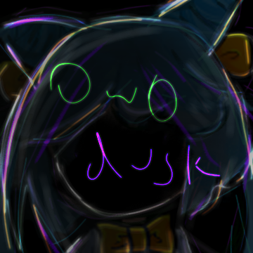

<div align="center">
  
  <h1>OwO-Dusk (bản âu-âu)</h1>
</div>

OwO-Dusk chạy nhiều tài khoản Discord cùng lúc. Mỗi tài khoản tự gửi các lệnh của bot OwO trong kênh bạn chọn, và có dashboard web để theo dõi. Đây là bản chỉnh sửa của OwO-Dusk do EchoQuill phát triển, phiên bản 2.6.11. Lịch sử thay đổi nằm trong [CHANGELOG.md](CHANGELOG.md).

> [!WARNING]
> Chương trình này dùng tài khoản người dùng Discord (selfbot). Việc đó vi phạm Điều khoản dịch vụ của Discord và có thể khiến tài khoản của bạn bị khoá. Bạn tự chịu rủi ro khi dùng. Hãy cân nhắc kỹ, nhất là với tài khoản mà bạn không muốn mất.

## Mục lục

- [Tính năng chính](#tính-năng-chính)
- [Yêu cầu](#yêu-cầu)
- [Cài đặt](#cài-đặt)
- [Thêm tài khoản](#thêm-tài-khoản)
- [Chạy bot](#chạy-bot)
- [Dashboard web](#dashboard-web)
- [Cấu hình](#cấu-hình)
- [Khi gặp captcha](#khi-gặp-captcha)
- [Dữ liệu và log](#dữ-liệu-và-log)
- [Cập nhật lên bản mới](#cập-nhật-lên-bản-mới)
- [Gỡ lỗi thường gặp](#gỡ-lỗi-thường-gặp)
- [Giấy phép và ghi công](#giấy-phép-và-ghi-công)

## Tính năng chính

- **Nhiều tài khoản cùng lúc.** Mỗi tài khoản chạy trên luồng riêng. Các tài khoản khởi động theo đợt. Số tài khoản mỗi đợt và khoảng chờ giữa các đợt là `account.waveSize` và `account.waveDelay`.
- **Lệnh tự động, bật tắt từng lệnh.** Săn và chiến đấu (hunt, battle), cầu nguyện và nguyền rủa (pray, curse), daily, mail, cookie, xổ số, cửa hàng, bán thú săn, gems và lootbox, Hunt Bot, trò chơi may rủi (coinflip, slots, blackjack), boss battle, giveaway, quest (đang thử nghiệm) và tăng cấp (`commands.lvlGrind`). Mỗi lệnh có khoá `enabled` riêng trong `config/settings.json`.
- **Phát hiện captcha.** Bot tạm dừng tài khoản gặp captcha và gửi thông báo. Xem [Khi gặp captcha](#khi-gặp-captcha).
- **Kiểm tra cấp độ bằng OCR.** Tính năng `levelCheck` đọc thẻ cấp độ bằng Tesseract. Không có Tesseract thì tính năng này tắt, các tính năng khác vẫn chạy. Lịch sử được lưu trong `utils/data/levels.sqlite`, nên không mất khi khởi động lại. Lần kiểm tra đầu tiên của mỗi tài khoản được chọn ngẫu nhiên từ 15 đến 75 phút.
- **Dashboard web.** Trạng thái, biểu đồ, danh sách tài khoản, nút Start, Stop và Restart cho bot, giao diện sáng hoặc tối, tiếng Việt hoặc tiếng Anh, và trang điện thoại `/m`. Mật khẩu là tuỳ chọn nhưng nên đặt khi mở ra mạng. Xem [Dashboard web](#dashboard-web).
- **Tự dừng.** Bot dừng sau một khoảng thời gian (`autoStop`) hoặc theo tham số `--max-runtime`.
- **Tự làm nhiệm vụ (quest), tắt mặc định.** Chỉ chạy khi bật đủ `autoQuest.enabled`, `allow_auto_quest` và có tài khoản trong `auto_quest_accounts`. Nên thử một tài khoản trước. Xem mục [Cấu hình](#cấu-hình).
- **Điều khiển bằng tin nhắn.** Gửi từ chính tài khoản (hoặc từ ID trong `textCommands.allowedUsers`) các lệnh để dừng, chạy lại, cho ngủ hoặc đổi kênh. Tiền tố là `textCommands.prefix`.
- **Thông báo.** Thông báo trên máy (tuỳ hệ điều hành) và qua webhook Discord, webhook mặc định tắt.
- **Nhật ký và thống kê.** Nhật ký chạy nằm trong `logs/`, dữ liệu nằm trong `utils/data/`. Xem [Dữ liệu và log](#dữ-liệu-và-log).

## Yêu cầu

- Python 3.12 trở lên.
- Git, vì `discord.py-self` được cài từ GitHub. `setup.py` báo nếu máy chưa có Git.
- Kết nối Internet tới Discord và tới các địa chỉ liệt kê trong [Kết nối ra ngoài](#kết-nối-ra-ngoài).
- Tesseract OCR, chỉ cần cho `levelCheck`. Không bắt buộc.
- Trên Termux: ứng dụng Termux:API, để các lệnh `termux-*` chạy được.

## Cài đặt

### Cài trên Windows

1. Cài Python 3.12 trở lên từ [python.org](https://www.python.org/downloads/). Khi cài, tick **Add Python to PATH**.
2. Cài [Git for Windows](https://git-scm.com/download/win) nếu máy chưa có Git.
3. Mở thư mục dự án và nhấp đúp `setup.bat`. Script chạy 7 bước:
   1. kiểm tra Python;
   2. kiểm tra pip;
   3. cài các thư viện trong `requirements.txt`;
   4. hỏi có tải Tesseract bản portable (khoảng 50–80 MB, vào `third_party/tesseract`) không;
   5. tạo thư mục `logs/` và `utils/data/` nếu thiếu;
   6. kiểm tra các file cấu hình có đọc được không. Chỉ báo tên file và vị trí lỗi, không in nội dung;
   7. tự kiểm tra OCR.

   Setup chỉ thêm hoặc kiểm tra. Nó không xoá file, không ghi đè file có sẵn và không đụng vào `tokens.txt`. Có thể chạy lại nhiều lần.
4. Nếu bước 4 không tải được, làm theo hướng dẫn cài tay được in ra màn hình, rồi chạy lại `setup.bat`.

### Cài trên Linux macOS và Termux

1. Cài Python 3.12 trở lên. Lệnh thường dùng là `python3`.
2. Mở terminal trong thư mục dự án và chạy:

   ```bash
   bash setup.sh
   ```

   Các bước giống `setup.bat`. `setup.sh` gọi `setup.py` bằng Python tìm được trên máy.
3. Tesseract (tuỳ chọn, cho `levelCheck`):
   - macOS: setup in lệnh `brew install tesseract`.
   - Linux: setup hỏi có chạy `sudo apt install tesseract-ocr` không. Mặc định là không.
   - Termux: setup hỏi có chạy `pkg install -y tesseract` không. Mặc định là không.
4. Trên Termux, numpy, pillow và onnxruntime lấy từ kho gói của Termux (`python-numpy`, `python-pillow`, `python-onnxruntime`). Setup hỏi trước khi cài.

## Thêm tài khoản

Bot đọc tài khoản từ `tokens.txt`, nằm cạnh `uwu.py`. Mỗi dòng là một tài khoản, gồm đúng hai trường cách nhau bằng khoảng trắng: token và ID kênh. Dòng trống và dòng bắt đầu bằng `#` được bỏ qua.

```text
# Dòng bắt đầu bằng # và dòng trống bị bỏ qua
MTAwMDAwMDAwMDAwMDAwMDAw.FAKEFA.token_gia_chi_de_minh_hoa 123456789012345678
```

- **Token là bí mật**, giống mật khẩu. Không gửi cho người khác và không đăng lên diễn đàn hay GitHub. `tokens.txt` đã có trong `.gitignore`.
- **Lấy ID kênh.** Vào **Cài đặt người dùng → Nâng cao** và bật **Chế độ nhà phát triển** (Developer Mode). Sau đó nhấp chuột phải vào kênh và chọn **Sao chép ID kênh**.
- Tài khoản phải truy cập được kênh đó. Nếu không, bot báo `Bot lacks permissions to access channel <ID kênh>.`
- Mỗi tài khoản một dòng. Nếu `tokens.txt` chưa có, bot tự tạo file rỗng khi chạy, in hướng dẫn rồi thoát.
- Cấu hình riêng cho từng tài khoản: xem [Cấu hình](#cấu-hình).

## Chạy bot

### Chạy trên Windows

- Nhấp đúp `start.bat`, hoặc chạy `start.bat` trong terminal. Có thể thêm tuỳ chọn, ví dụ `start.bat --max-runtime 60`.
- `start.bat` tìm Python giống `setup.bat`. Nếu không thấy, nó báo lỗi và dừng.
- Khi bot dừng, cửa sổ in `[*] Bot da dung. Dong cua so nay neu khong can nua.` và chờ bạn nhấn phím.

### Chạy trên Linux macOS và Termux

Chạy trong thư mục dự án:

```bash
bash start.sh
```

Tuỳ chọn giống Windows, ví dụ `bash start.sh --max-runtime 60`.

### Tuỳ chọn dòng lệnh

| Lệnh | Kết quả |
|---|---|
| `start.bat` hoặc `bash start.sh` | Chạy theo `autoStop` trong cấu hình. Mặc định bật, dừng sau 133 phút |
| `--max-runtime 60` | Chạy đúng 60 phút rồi dừng mọi tài khoản và thoát. Thay cho `autoStop.afterMinutes` ở lần chạy này |
| `--max-runtime 1` | Giá trị nhỏ nhất: 1 phút |
| `--max-runtime 10080` | Giá trị lớn nhất: 10080 phút (7 ngày) |
| `--max-runtime 0.5` | Báo lỗi `'0.5' is not a whole number of minutes`. Chỉ nhận số nguyên |
| `--max-runtime 20000` | Báo lỗi `20000 is not from 1 to 10080 minutes` |

**Tự dừng.** Khi `autoStop.enabled` là `true` (mặc định), bot in `autoStop: ON, will stop at ...` và dừng sau `autoStop.afterMinutes` phút. Khi tắt, bot in `autoStop: OFF`. Đến giờ, bot dừng mọi tài khoản. Mỗi tài khoản có tối đa `autoStop.graceSeconds` giây (mặc định 90) để hoàn tất lệnh đang chờ và ghi dữ liệu. Sau đó bot thoát với mã 0.

**Dừng bằng tay.** Nhấn `Ctrl+C`. Bot in `Ctrl+C detected. stopping code!` rồi thoát.

## Dashboard web

Dashboard chạy cùng bot khi `website.enabled` là `true` (mặc định). Cổng là `website.port`, mặc định 1200. Mở `http://127.0.0.1:1200/` trong trình duyệt trên cùng máy.

- **Địa chỉ nghe.** Khoá `website.host` quyết định (mặc định `0.0.0.0`). `website.enableHost` không còn dùng để chọn địa chỉ, file cũ có `enableHost` là `false` cũng nghe theo `website.host`. Chỉ đặt `website.host` là `127.0.0.1` thì dashboard luôn chỉ mở trên máy này.
- **Cho máy khác trong mạng.** Cần `website.host` là `0.0.0.0` và mật khẩu từ 8 ký tự trở lên. Khi khởi động, bot in địa chỉ LAN (`Dashboard (LAN): http://...`) và địa chỉ máy này (`Dashboard (máy này): http://127.0.0.1:...`).
- **Mật khẩu.** Đặt trong `website.password`, ở `config/global_settings.json`. Mật khẩu trống hoặc ngắn hơn 8 ký tự thì dashboard chỉ mở trên máy này (`127.0.0.1`) và bot in một dòng cảnh báo tiếng Việt nói rõ lý do. Dashboard không bao giờ mở cho mạng LAN khi chưa có mật khẩu đủ dài.
- **Giao diện.** Giao diện phẳng, tối giản, nền động WebGL nhẹ (tự dừng khi tab bị ẩn và khi hệ điều hành bật giảm chuyển động; không có WebGL thì dùng nền màu phẳng). Có chế độ sáng, tối và tự động theo hệ thống, tiếng Việt hoặc tiếng Anh, và trang điện thoại tại `/m`. Mọi tài nguyên nằm trong bot, không tải từ CDN.
- **Dashboard riêng.** `dashboard.bat` mở dashboard mà không chạy bot, dùng cổng trong cấu hình. `dashboard.bat 1201` dùng cổng 1201, hữu ích khi cổng 1200 đang được bot dùng.
- **Sửa cấu hình trên dashboard.** Dashboard lưu được một phần cấu hình, sau khi kiểm tra kiểu dữ liệu và giới hạn. Các khoá sau bị khoá: sửa trên dashboard sẽ trả lỗi `locked_key`. Hãy sửa tay trong `config/global_settings.json`: `console.commandToRunOnCaptcha`, `console.commandToRunOnBan`, `console.runConsoleCommandOnCaptcha`, `console.runConsoleCommandOnBan`, `levelCheck.tesseractPath`. Đây là các khoá có thể chạy chương trình trên máy.
- Dashboard không hiện mật khẩu, khoá OCR và URL webhook. Các giá trị này hiện là `***REDACTED***`.
- Trên trang Máy chủ, các ô lệnh console và `levelCheck.tesseractPath` chỉ đọc, kèm gợi ý “Chỉ sửa được trong file config/global_settings.json”.
- Nút Start, Stop và Restart điều khiển tiến trình bot. `dashboard.bat` và `dashboard.sh` mở dashboard riêng, không chạy bot.
- Sau khi sửa file cấu hình, khởi động lại bot để áp dụng.

## Cấu hình

Mọi cấu hình nằm trong thư mục `config/`. Các file phải đúng cú pháp JSON hoặc TOML. Setup kiểm tra điều này và báo vị trí lỗi.

| File | Dùng để | Ghi chú |
|---|---|---|
| `config/settings.json` | Cài đặt mặc định cho mọi tài khoản | File bạn sửa nhiều nhất |
| `config/<ID tài khoản>.settings.json` | Cài đặt riêng cho một tài khoản | Không có sẵn. Sao chép `settings.json`, đổi tên thành ID người dùng của tài khoản, rồi sửa. Bot dùng nguyên file này cho tài khoản đó, không gộp với file mặc định |
| `config/global_settings.json` | Cài đặt chung: dashboard, tự dừng, captcha, webhook, kiểm tra cấp độ | Có các khoá bị khoá trên dashboard |
| `config/misc.json` | Log, console, tên lệnh và bí danh | Không nên sửa trừ khi bạn hiểu rõ |
| `config/captcha.toml` | Bộ giải captcha | Dịch vụ bên thứ ba tắt mặc định |
| `config/danger.toml` | Ba tính năng có rủi ro: quest tự động, câu trích dẫn, chuyển kênh | Đọc chú thích trong file trước khi bật |
| `config/webhookContent.json` | Mẫu nội dung thông báo webhook | Chỉ có tác dụng khi `webhook.enabled` bật |
| `config/level_lines.txt` | Danh sách câu cho lệnh tăng cấp, mỗi dòng một câu | Dùng khi `commands.lvlGrind.useQuoteInstead` bật |
| `tokens.txt` | Danh sách tài khoản | Bí mật, xem [Thêm tài khoản](#thêm-tài-khoản) |
| `audio/Beep.mp3` | Âm thanh khi có captcha | Đường dẫn cấu hình ở `captcha.playAudio.path`. Có thể là tên file trong `audio/` hoặc đường dẫn đầy đủ |

Chi tiết từng khoá: [docs/cau-hinh.md](docs/cau-hinh.md).

**Tự làm nhiệm vụ (quest).** Tắt mặc định. Để bật: đặt `autoQuest.enabled` là `true` trong `config/settings.json`, đặt `allow_auto_quest` là `true` trong `config/danger.toml`, rồi đưa ID người dùng (hoặc 4 chữ số cuối) của một tài khoản thử vào `auto_quest_accounts`. Nên thử một tài khoản trước. Khi `autoQuest.helpOthers` bật, các tài khoản trong danh sách giúp nhau làm nhiệm vụ; OwO có thể thấy các tài khoản này liên kết với nhau.

**Gateway gọn.** `gateway.lean` bật mặc định: bot chỉ nhận sự kiện từ kênh spam và DM với OwO, không đăng ký mọi server và không tải danh sách thành viên. Các khoá khác của khối này nằm trong `docs/cau-hinh.md`.

**Câu trích cho lệnh tăng cấp.** Mặc định lấy từ dịch vụ bên ngoài (`commands.lvlGrind.quoteSource` là `api`). Đặt `file` để chỉ dùng `config/level_lines.txt`.

## Khi gặp captcha

Khi bot phát hiện captcha, bot tạm dừng tài khoản đó, gửi thông báo, và người dùng tự giải captcha bằng tay trên Discord.

Trong `config/captcha.toml` có các tuỳ chọn giải captcha tự động: `image_solver.enabled`, `hcaptcha_solver.captchaly.enabled` và `hcaptcha_solver.yescaptcha.enabled`. Tất cả đều tắt mặc định.

## Dữ liệu và log

Các file dưới đây được tạo khi bot chạy. `.gitignore` loại chúng khỏi git.

| Đường dẫn | Nội dung |
|---|---|
| `logs/run_NĂM-THÁNG-NGÀY_GIỜ-PHÚT-GIÂY.txt` | Bản chữ của mọi dòng console và nhật ký tài khoản. Bật bởi `debug.logInTextFile`. Khi file đạt `debug.logMaxMB` (mặc định 20 MB), bot mở file mới. Số file giữ lại tối đa là `debug.logKeepFiles` (mặc định 20) |
| `utils/data/db.sqlite` | Thống kê lệnh, cash và người dùng. Ghi khi `database.logStatistics` bật |
| `utils/data/web_console.sqlite` | Nhật ký console hiển thị trên dashboard |
| `utils/data/live_status.json` | Trạng thái trực tiếp của các tài khoản. Bot ghi khoảng 5 giây một lần cho dashboard |
| `utils/data/weekly_runtime.json` | Thời gian chạy theo ngày, dùng cho biểu đồ Weekly Runtime |
| `utils/data/levels.sqlite` | Lịch sử kiểm tra cấp độ. Lịch sử cũ hơn 90 ngày bị xoá |
| `utils/data/quests.sqlite` | Trạng thái nhiệm vụ (quest), giữ qua các lần chạy |
| `utils/data/bot.pid` | Mã tiến trình của bot đang chạy. Bot xoá khi thoát |
| `utils/data/control/` | Lệnh dừng và trạng thái thoát do dashboard ghi và bot đọc |
| `utils/data/level_debug.jsonl` | Nhật ký mỗi lần kiểm tra cấp độ, khi `levelCheck.debug` bật. Khi file đạt giới hạn dung lượng, file cũ được đổi tên thành `.1` |

Bot che token Discord, URL webhook và khoá API khi ghi nhật ký.

### Kết nối ra ngoài

Ngoài kết nối tới Discord, bot có thể liên lạc các địa chỉ sau:

- **Discord** (`discord.com` và gateway của Discord): kết nối bắt buộc để chạy tài khoản.
- **Dịch vụ thông số trình duyệt** `https://cordapi.dolfi.es/api/v2/properties/web` là dịch vụ của bên thứ ba. Khi bắt đầu chạy mỗi tài khoản, bot hỏi dịch vụ này để tạo header giống trình duyệt. Nếu lỗi, bot tự lấy thông số từ `https://discord.com/login`, `https://static.discord.com` và `https://versionhistory.googleapis.com`.
- **API của dự án gốc** `https://echoquill.github.io/owo-dusk-api`: khi khởi động, bot kiểm tra phiên bản (`version.json`). Nếu `news` bật (mặc định), bot tải tin tức (`news.json`). Cứ 30 giây, bot tải `safety_check.json` và `version.json`. Nếu cờ báo phiên bản này không an toàn, bot tạm dừng gửi lệnh và in dòng `Safety check: paused (remote flag)`. Khi cờ được gỡ, bot tự tiếp tục và in `Safety check: resumed`, không cần khởi động lại.
- **`https://blv-anh-ngok-said.onrender.com/api/quotes/{id}`** (id từ 1 đến 10): câu nói tiếng Việt cho lệnh tăng cấp, khi `commands.lvlGrind.enabled` và `commands.lvlGrind.useQuoteInstead` bật và `commands.lvlGrind.quoteSource` là `api` (mặc định). Bot lấy 10 câu khi khởi động rồi cứ 6 giờ lấy lại. Lỗi mạng thì bot dùng `config/level_lines.txt`, không dừng. Đặt `quoteSource` là `file` để không gọi dịch vụ này. Tắt hẳn bằng `allow_quotes` là `false` trong `config/danger.toml`.
- **`https://api.ocr.space/parse/image`**: chỉ khi bạn đặt `ocrApi` trong `config/global_settings.json` và Tesseract không đọc được ảnh nhiệm vụ (quest). Khi `ocrApi` để trống, bot không gọi dịch vụ này và không dùng khoá thử nghiệm.
- **`https://owobot.com/captcha`**: chỉ khi `captcha.openCaptchaWebsite` bật, bot mở trang này trong trình duyệt của máy.
- **Webhook Discord**: chỉ khi `webhook.enabled` bật, tới URL bạn cấu hình.
- **Dịch vụ giải captcha bên thứ ba**: chỉ khi bạn bật trong `config/captcha.toml`. Mặc định tắt.

## Cập nhật lên bản mới

1. Trước khi thay thư mục, sao lưu những gì bạn muốn giữ: `tokens.txt`, thư mục `config/` (cả các file `<ID>.settings.json`) và `utils/data/`. Bản này không tự tạo file `.bak`, nên việc sao lưu là do bạn.
2. Chạy lại `setup.bat` (Windows) hoặc `bash setup.sh` để cài thư viện mới. Setup không xoá file và không ghi đè file cấu hình có sẵn.
3. Khởi động bot. Cơ sở dữ liệu cũ được nâng cấp tại chỗ và giữ dữ liệu. Khi có nâng cấp, bot in `Database upgraded from ... to ... (data kept)`.
4. Nếu khởi động báo lỗi về một khoá cấu hình, so file cũ với file trong bản mới rồi thêm khoá còn thiếu.
5. Khi kiểm tra được và máy chủ của dự án gốc có phiên bản mới hơn, bot in `Update Detected - <phiên bản>`.

## Gỡ lỗi thường gặp

| Thông báo (nguyên văn) | Cách xử lý |
|---|---|
| `Chưa có tài khoản nào trong tokens.txt.` | Thêm ít nhất một dòng `<token> <ID kênh>` vào `tokens.txt`. Bot thoát, không báo lỗi |
| `Dòng N trong tokens.txt sai định dạng, bỏ qua.` | Dòng N không có đúng hai trường. Sửa dòng đó. Bot không in nội dung dòng, để không lộ token |
| `[x] Khong tim thay Python tren may nay.` (start.bat) | Chưa có Python 3.12 trở lên, hoặc Python không nằm trong PATH. Cài Python rồi chạy `setup.bat` |
| `[x] Python was not found. Run setup.sh first.` (start.sh) | Chưa có Python trên máy. Cài Python 3.12 trở lên rồi chạy `bash setup.sh` |
| `[levelCheck] off: Tesseract OCR not found.` | Kiểm tra cấp độ tắt vì không tìm thấy Tesseract. Chạy setup để tải bản portable, hoặc cài Tesseract, hoặc đặt `levelCheck.tesseractPath` |
| `[quest] ocrApi chưa đặt, nên không gọi ocr.space: chỉ dùng Tesseract. Muốn dùng ocr.space, đặt khóa trong config/global_settings.json (ocrApi).` | Bình thường nếu bạn không đặt `ocrApi`. Dòng này chỉ in một lần cho mỗi lần chạy |
| `Dashboard chưa đặt mật khẩu: chỉ mở được trên máy này.` | Đặt `website.password`. Cho đến lúc đó, chỉ máy này mở được dashboard |
| `Mật khẩu dashboard quá ngắn (nên từ 8 ký tự trở lên).` | Đặt mật khẩu dài hơn |
| `{"ok": false, "error": "locked_key", "keys": [...]}` (HTTP 400) | Dashboard không sửa được khoá bị khoá. Sửa tay trong `config/global_settings.json` |
| `Safety check: paused (remote flag) - reason: ...` | Bot tạm dừng theo cờ từ xa của dự án gốc. Đọc lý do trong dòng này. Khi cờ được gỡ, bot in `Safety check: resumed`. Nếu dòng có `update to vX to continue`, cần cập nhật bản |
| `Bot lacks permissions to access channel <ID kênh>.` | Tài khoản không truy cập được kênh. Kiểm tra ID kênh trong `tokens.txt` |

## Giấy phép và ghi công

- Phần mềm được phát hành theo [GNU General Public License v3.0](LICENSE) (GPL-3.0).
- Bản này dựa trên OwO-Dusk của EchoQuill. Dòng bản quyền được giữ nguyên như trong mã nguồn:

Copyright (c) 2024-present EchoQuill

- Các thành phần của bên thứ ba và giấy phép của chúng: [THIRD_PARTY_NOTICES.md](THIRD_PARTY_NOTICES.md).
- Lịch sử thay đổi của bản này: [CHANGELOG.md](CHANGELOG.md).
- Theo GPL-3.0, bạn được chạy, nghiên cứu, sửa đổi và chia sẻ phần mềm. Khi chia sẻ bản gốc hoặc bản đã sửa, bạn phải cung cấp mã nguồn tương ứng và giữ nguyên giấy phép GPL-3.0.
